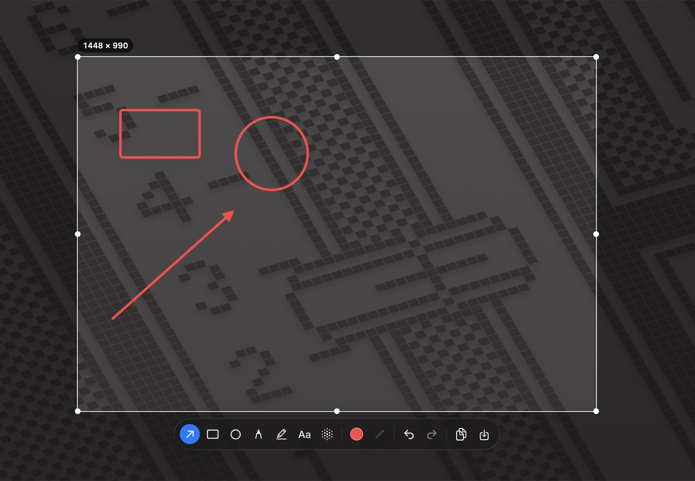

# Penknife

**La navaja de bolsillo para tu Mac.** 
Una pequeña app de la barra de menús que sustituye a Hammerspoon, MTMR, noTunes, Maccy y Lightshot.

[English](README.md) · **Español**

 

## Qué incluye

Cada parte es un módulo que puedes activar o desactivar.

### Touch Bar
Brillo, luz del teclado, volumen, música, tiempo, temperatura de la CPU, batería, test de velocidad y hora. Los iconos siguen el estado actual, y tú eliges qué botones aparecen y en qué orden.

<table>
<tr>
<td width="50%" valign="top">

<h3>Capturas de pantalla</h3>
Un editor con flechas, texto, resaltador, formas, lápiz y desenfoque. Congelada o en vivo, zona o ventana. Copia o guarda.
</td>
<td width="50%" valign="top">

<h3>Historial del portapapeles</h3>
Búsqueda, elementos fijados y pegar con ⌘1–⌘9. Nunca guarda lo que viene de gestores de contraseñas ni los elementos ocultos.
</td>
</tr>
<tr>
<td width="50%" valign="top">

<h3>Música</h3>
Reproduce, pausa y salta canciones en el reproductor que elijas. Los clics de los auriculares van a ese reproductor, y Apple Music ya no se abre solo.
</td>
<td width="50%" valign="top">

<h3>Barra de menús</h3>
Mover el ratón, silenciar el micrófono, bloquear la pantalla, test de velocidad y temperatura de la CPU, cada uno con su atajo. Unos puntos de estado muestran lo que está activo.
</td>
</tr>
</table>

### Ajustes
Una sola ventana al estilo de Ajustes del Sistema: cada módulo se activa o desactiva y tiene sus propios atajos.

### Un extra
Mantén pulsado el botón de mover el ratón 3 segundos y corta fruta en la Touch Bar.

## Instalación

1. [Descarga la última versión](https://github.com/alexl-l/penknife/releases/latest), descomprímela y mueve `Penknife.app` a `/Aplicaciones`.
2. Ábrela. Penknife no está notarizada (no hay cuenta de pago de Apple Developer), así que macOS la bloquea la primera vez: ve a **Ajustes del Sistema → Privacidad y seguridad** y pulsa **Abrir igualmente**.

<b>Requisitos</b>

- macOS 26 o posterior.
- El módulo Touch Bar necesita un MacBook Pro con Touch Bar.

<b>Permisos</b>

Penknife pide solo lo que necesitan los módulos que actives:

- **Accesibilidad**: atajos que actúan sobre otras apps, teclas multimedia y mover el ratón.
- **Automatización (Apple Events)**: para controlar Spotify y Apple Music.
- **Ubicación** (opcional): el tiempo local.
- **Grabación de pantalla**: capturas de pantalla.

<b>Privacidad</b>

Penknife no tiene cuenta, ni analíticas, ni rastreo.

- **El tiempo** envía a [Open-Meteo](https://open-meteo.com/) solo coordenadas redondeadas a unos 11 km. Open-Meteo ve tu dirección IP.
- **El test de velocidad** usa la herramienta `networkQuality` de macOS, que contacta con servidores de prueba de Apple.
- **El historial del portapapeles** y **las capturas** se quedan en tu Mac.

<b>APIs privadas</b>

Penknife no es una app de la App Store. Usa algunos frameworks privados de macOS, por ejemplo para mostrar su propia Touch Bar y ajustar el brillo de la pantalla y del teclado. Una actualización de macOS puede romper un módulo. Si pasa, ese módulo deja de funcionar y el resto de la app sigue.

<b>Compilar desde el código</b>

1. Crea un certificado de firma de código llamado `Penknife Local Signing` en tu llavero de inicio de sesión (Acceso a Llaveros → Asistente de certificados → Crear un certificado, tipo *Firma de código*). Una firma estable conserva los permisos de privacidad entre compilaciones.
2. Ejecuta `scripts/install.sh`. Compila una versión Release, la firma y la instala en `/Aplicaciones`.

Consulta [CHANGELOG.md](CHANGELOG.md) para ver los cambios de cada versión.

## Licencia

[MIT](LICENSE). Avisos de terceros: [THIRD_PARTY_LICENSES.md](THIRD_PARTY_LICENSES.md).

Penknife no está afiliada ni respaldada por Apple, Spotify, Hammerspoon, MTMR, noTunes, Maccy ni Lightshot. Los nombres se usan solo para describir la compatibilidad.
