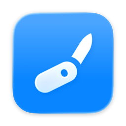
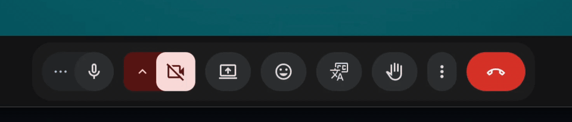
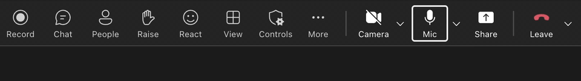
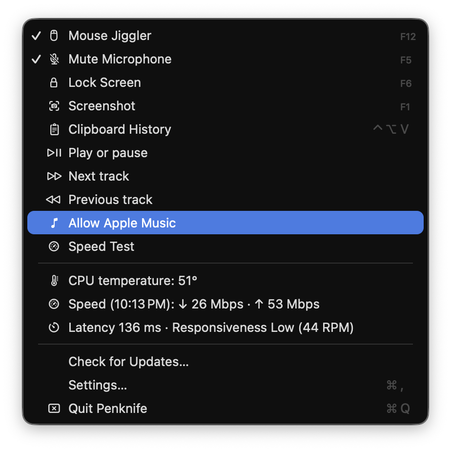
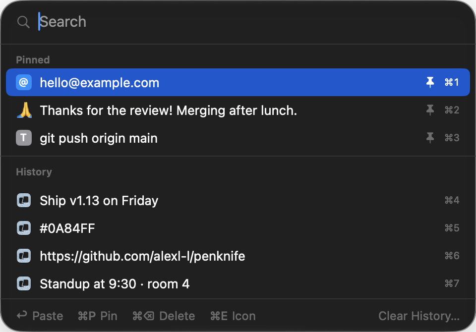
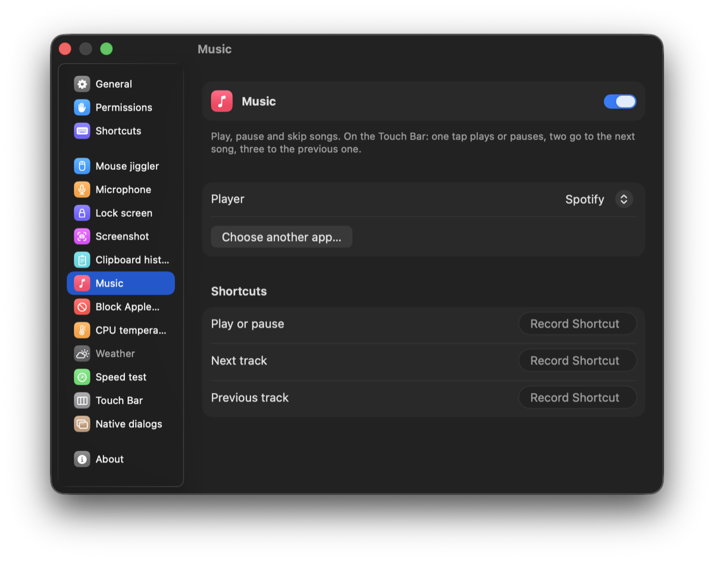
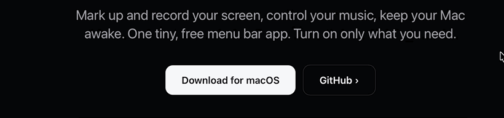
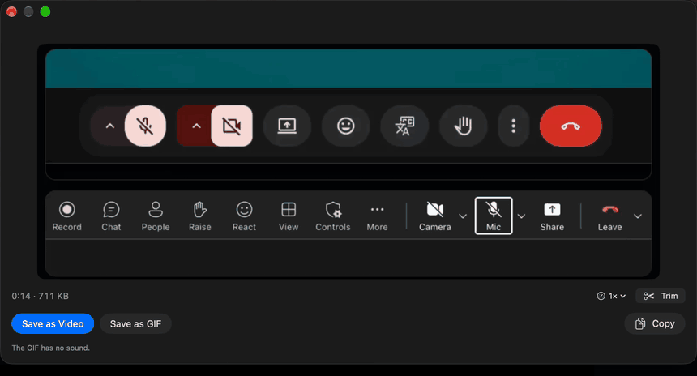
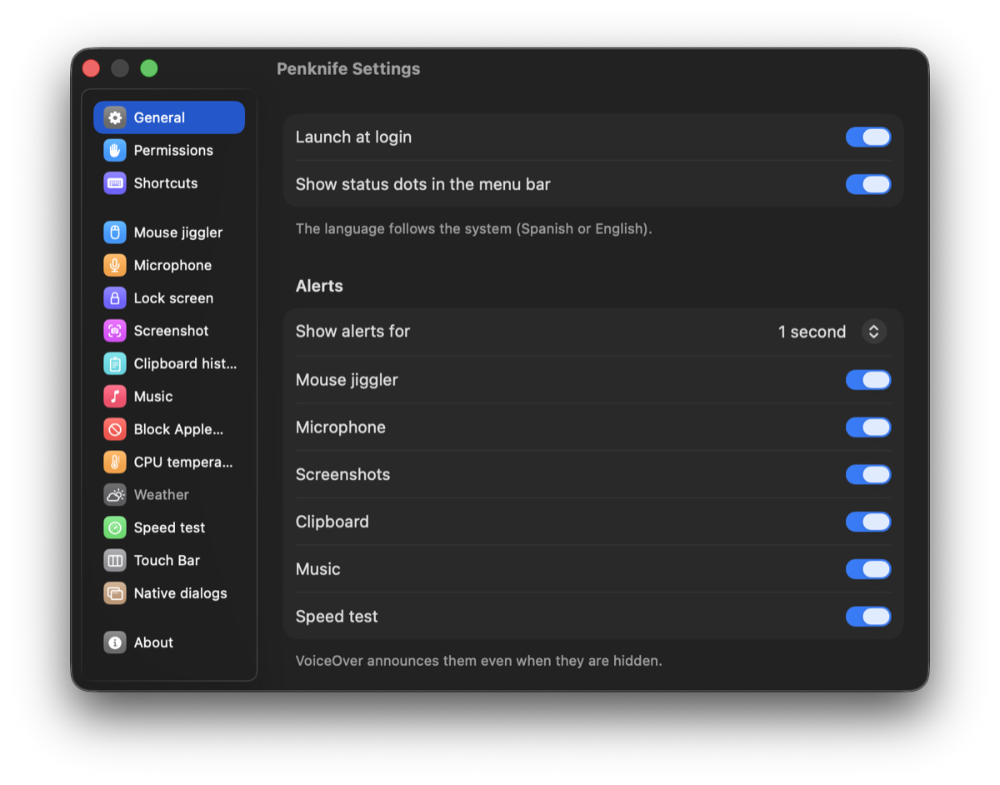

<div align="center">



# Penknife

**Silencia la reunión en la que estás, encuentra lo que copiaste, marca y graba tu pantalla.**<br>
Una app diminuta de la barra de menús para tu Mac. Gratis y de código abierto.

<a href="https://github.com/alexl-l/penknife/releases/latest"></a>


[English](README.md) · **Español**

<br><br>
<br>
<sub>Pulsa un atajo: la llamada se silencia y su botón del micrófono se actualiza.</sub>

</div>

## Qué incluye

Cada parte es un módulo. Desactiva lo que no necesites y no gastará CPU ni memoria. Funciona en cualquier Mac; no necesitas Touch Bar.

<table>
<tr>
<td width="50%" valign="top">

<h3>Silenciar el micrófono en reuniones</h3>
Un atajo silencia la reunión en la que estás: Teams, Google Meet, Zoom, Slack Huddles o Webex. Solo cuentan las apps con una llamada en curso, y cada una usa su propio atajo, que puedes editar en Ajustes. Sin llamada, silencia el micrófono del Mac. El icono y el punto de estado muestran siempre el estado real.

Silenciado se queda silenciado: si "Oye Siri" abre el micrófono del Mac porque el Mac ha reproducido un sonido, Penknife lo vuelve a silenciar en un momento ("Mantener el micrófono silenciado" en Ajustes, activado por defecto).

Opcional, desactivado por defecto: si al activar el micrófono en Teams con el atajo, Teams te pide consentimiento, Penknife puede aceptarlo por ti. Sigues siendo responsable del consentimiento; consulta la política de tu empresa. Penknife no está afiliado a Microsoft.
</td>
<td width="50%" valign="top">

<h3>Historial del portapapeles</h3>
Ábrelo con ⌃⌥V, busca, fija lo que más usas (con una letra o un emoji propio como icono, ⌘E) y pega con ⌘1–⌘9. El historial vive solo en memoria; lo fijado se conserva. Nunca guarda contraseñas ni otros elementos ocultos.
</td>
</tr>
<tr>
<td width="50%" valign="top">

<h3>Capturas y grabación de pantalla</h3>
Pulsa F1, selecciona un área o una ventana (con Espacio), márcala con flechas, líneas, texto, resaltador, formas, lápiz y desenfoque, y copia o guarda. Después puedes mover, cambiar de tamaño o borrar cualquier marca. Pega el resultado en una carpeta del Finder como archivo. No se sube nada a internet.

Graba toda la pantalla, un área o una ventana como vídeo o GIF (⌃⌥R), o mantén pulsado el atajo de Captura de pantalla (F1) 2 segundos, elige un área y empieza a grabar. Dibuja mientras grabas, con el sonido del Mac y tu micrófono si quieres, y recorta el principio y el final y elige una velocidad (1×, 1,5×, 2× o 4×) antes de guardar.
</td>
<td width="50%" valign="top">

<h3>Música</h3>
Reproduce, pausa y salta canciones en el reproductor que elijas: Spotify, Apple Music, YouTube Music, Amazon Music o cualquier otra app. Los clics de los auriculares van a ese reproductor, y Apple Music no se abre hasta que tú lo abres.
</td>
</tr>
</table>

### Dibuja mientras grabas
Arrastra una zona, o pulsa Espacio y haz clic en una ventana, o pulsa Intro para toda la pantalla: la grabación empieza tras un 3-2-1. Tus marcas aparecen en el archivo y se quedan o se desvanecen pasado el tiempo que elijas.



### Acelérala antes de guardar
Elige 1,5×, 2× o 4× en la ventana de la grabación. La vista previa, el vídeo guardado, el GIF y la copia la siguen, la voz mantiene su tono y la nota muestra cuánto durará el resultado.



### Y en la barra de menús
Mover ratón mantiene el Mac despierto y tu estado activo: mueve el puntero tras 10 segundos sin actividad (o el tiempo que elijas) y descansa con el Mac bloqueado. Bloquear pantalla bloquea el Mac al momento. Prueba de velocidad muestra bajada, subida y latencia en kbps, Mbps o Gbps. El tiempo, la temperatura del Mac y Prueba de velocidad también pueden estar en la barra de menús, activados por defecto en Macs sin Touch Bar. Cada opción tiene su propio atajo y unos puntos de estado muestran lo que está activado. Los avisos son discretos y aparecen arriba en el centro, bajo la barra de menús o el notch, así que nunca tapan las notificaciones de Apple. Tú eliges cuáles aparecen y cuánto duran (de 1 a 15 segundos).

### Ajustes
Una sola ventana al estilo de Ajustes del Sistema: activa o desactiva cada módulo y dale su propio atajo. Penknife se abre al iniciar sesión (puedes desactivarlo) y sigue el idioma del sistema, español o inglés.



### ¿Tienes Touch Bar?
Penknife añade la suya: brillo, luz del teclado, volumen, música, tiempo, temperatura de la CPU, batería, Prueba de velocidad y hora, a un toque. Los iconos siguen el estado actual: toca la batería para ver porcentaje o icono, mantenla pulsada para cambiar los colores. Tú eliges qué botones aparecen y en qué orden. Cuando una app muestra un aviso, la barra se aparta para que veas los botones de la propia app. ¿Vienes de MTMR? Ciérralo antes de activar la Touch Bar, o las dos barras se irán sustituyendo una a otra.


Un extra: mantén pulsado el botón de Mover ratón 3 segundos y corta fruta en la Touch Bar.


## Instalación

¿Prefieres Homebrew? Ejecuta `brew trust alexl-l/tap && brew install --cask alexl-l/tap/penknife`. Si no:

1. [Descarga la última versión](https://github.com/alexl-l/penknife/releases/latest), descomprímela y mueve `Penknife.app` a `/Aplicaciones`.
2. Ábrela. Penknife no está notarizada (no hay cuenta de pago de Apple Developer), así que macOS la bloquea la primera vez: ve a **Ajustes del Sistema › Privacidad y seguridad** y pulsa **Abrir igualmente**.

   **¿No aparece Abrir igualmente o el aviso vuelve a salir?** Pasa en Macs gestionados por una empresa o un colegio, donde un perfil bloquea las apps sin notarizar. Quita la marca de "descargado de internet" en Terminal y vuelve a abrir Penknife:
   ```
   xattr -dr com.apple.quarantine /Applications/Penknife.app
   ```
   Si es un Mac del trabajo, consúltalo antes con tu equipo de informática.
3. Listo. Penknife busca actualizaciones una vez al día y pregunta antes de instalarlas (menú → **Buscar actualizaciones…**).

<details>
<summary><b>Requisitos</b></summary>

- macOS 26 o posterior, en cualquier Mac.
- La sección Touch Bar es opcional y necesita un MacBook Pro con Touch Bar.

</details>

<details>
<summary><b>Permisos</b></summary>

Penknife pide solo lo que necesitan los módulos que actives. Ajustes › Permisos muestra el estado de cada uno:

- **Accesibilidad**: atajos que actúan sobre otras apps, teclas multimedia, Mover ratón y leer el botón de silencio de la reunión para que la llamada y el Mac coincidan.
- **Automatización (Apple Events)**: para controlar Spotify y Apple Music.
- **Localización** (opcional): el tiempo local.
- **Grabación de pantalla y del audio del sistema**: capturas y grabaciones de pantalla (con el sonido del Mac).
- **Micrófono** (opcional): solo si lo activas al grabar.

</details>

<details>
<summary><b>En Chrome, la reunión y el micrófono del Mac no coinciden</b></summary>

Al pulsar el atajo, Penknife lee el botón de silencio de la reunión para que la llamada y el micrófono del Mac queden igual. Chrome solo muestra ese botón a otras apps si su accesibilidad está activa, y se puede bloquear:

1. Abre `chrome://accessibility` (`opera://accessibility`, `edge://accessibility` o `brave://accessibility` en esos navegadores).
2. Comprueba que **Suppress automatic accessibility enablement from platform API consumers** está desmarcada. Deja también desmarcada **Lock the current accessibility mode**.
3. **Native accessibility API support** y **Web accessibility** deben estar activas (se activan solas cuando nada las bloquea). Las demás casillas no hacen falta.

Safari no necesita nada. Si no se puede leer el botón, Penknife envía igualmente el atajo de la reunión.

</details>

<details>
<summary><b>Mi atajo quita el silencio, pero no silencia (o no hace nada en la reunión)</b></summary>

Penknife silencia la reunión pulsando las teclas que tiene esa app en Ajustes › Micrófono. Si la app usa otras teclas, en la llamada no pasa nada. Suele ocurrir tras cambiar el atajo dentro de Teams, Zoom o Slack.

1. Abre los ajustes de la app de reuniones y busca su atajo para silenciar (en Teams: Configuración → General → Métodos abreviados de teclado).
2. En Penknife, abre Ajustes › Micrófono, busca la app y graba las mismas teclas.
3. Entra en una llamada y pulsa tu atajo de Penknife. El botón de silencio de la llamada debe cambiar.

</details>

<details>
<summary><b>"Oye Siri" abre mi micrófono cuando el Mac reproduce un sonido</b></summary>

Con "Oye Siri" activado, macOS puede abrir el micrófono unos segundos cuando el Mac reproduce un sonido, aunque estés silenciado. "Mantener el micrófono silenciado" (Ajustes › Micrófono, activado por defecto) lo vuelve a silenciar en un momento. Si llamas tú a Siri, te sigue oyendo. Si prefieres que Siri no escuche mientras estás silenciado, puedes cambiar "Al oír" en los ajustes de Siri.

</details>

<details>
<summary><b>Privacidad</b></summary>

Penknife no tiene cuenta, ni analíticas, ni rastreo.

- **El tiempo** envía a [Open-Meteo](https://open-meteo.com/) solo coordenadas redondeadas a unos 11 km. Open-Meteo ve tu dirección IP.
- **Prueba de velocidad** usa la herramienta `networkQuality` de macOS, que contacta con servidores de prueba de Apple.
- **El historial del portapapeles**, **las capturas** y **las grabaciones de pantalla** se quedan en tu Mac.

</details>

<details>
<summary><b>APIs privadas</b></summary>

Penknife no es una app de la App Store. Usa algunos frameworks privados de macOS, por ejemplo para mostrar su propia Touch Bar y ajustar el brillo de la pantalla y del teclado. Una actualización de macOS puede romper un módulo. Si pasa, ese módulo deja de funcionar y el resto de la app sigue.

</details>

<details>
<summary><b>Compilar desde el código</b></summary>

1. Crea un certificado de firma de código llamado `Penknife Local Signing` en tu llavero de inicio de sesión (Acceso a Llaveros → Asistente de certificados → Crear un certificado, tipo *Firma de código*). Una firma estable conserva los permisos de privacidad entre compilaciones.
2. Ejecuta `scripts/install.sh`. Compila una versión Release, la firma y la instala en `/Aplicaciones`.

</details>

Consulta [CHANGELOG.md](CHANGELOG.md) para ver los cambios de cada versión.

## Licencia

[MIT](LICENSE). Avisos de terceros: [THIRD_PARTY_LICENSES.md](THIRD_PARTY_LICENSES.md).

Penknife no está afiliada ni respaldada por Apple ni Spotify. Los nombres se usan solo para describir la compatibilidad.
