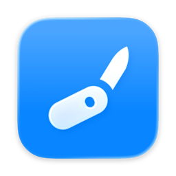
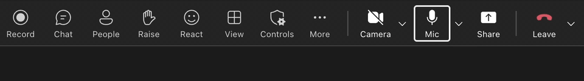
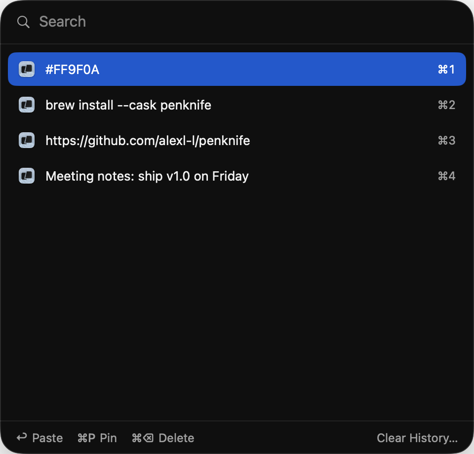
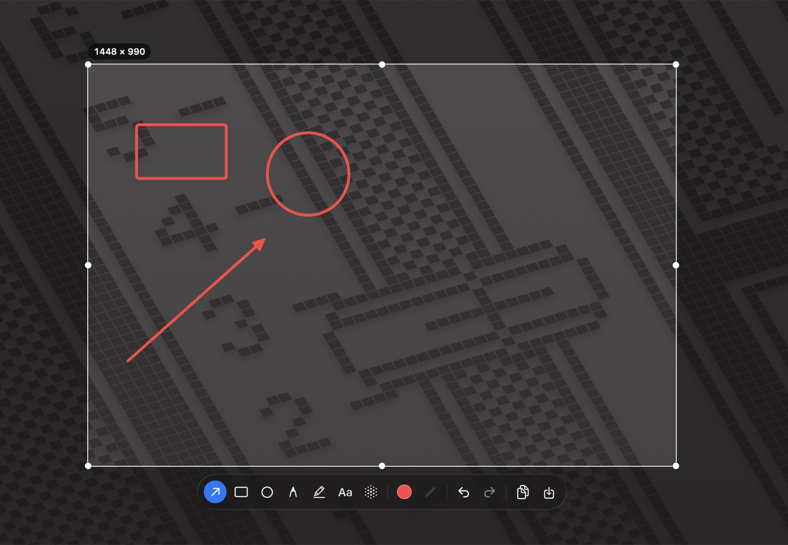
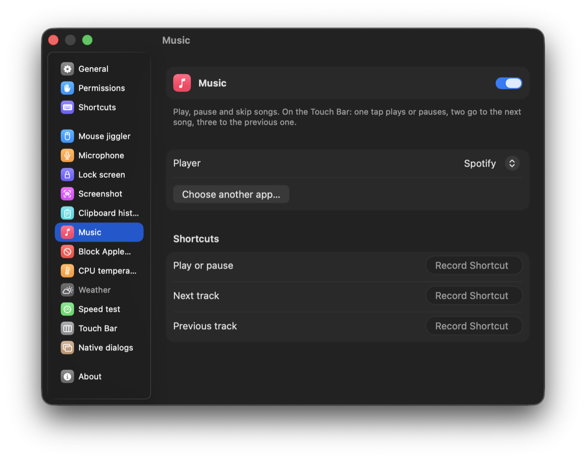
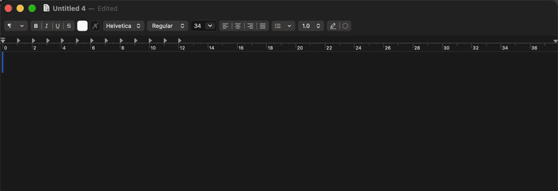
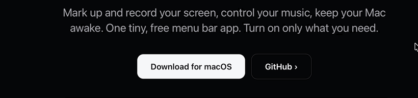
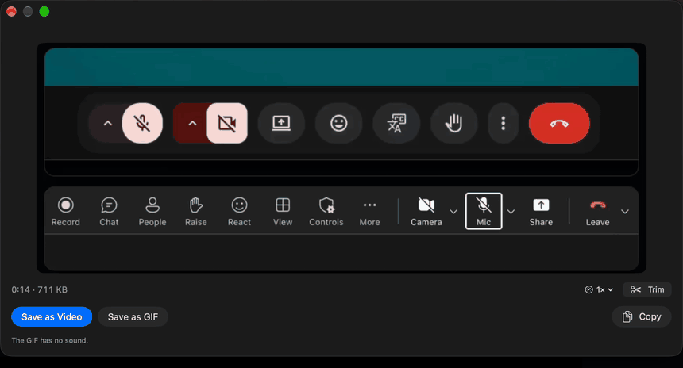

<div align="center">



# Penknife

**Mute the meeting you're in, find anything you copied, mark up and record your screen.**<br>
One tiny menu bar app for your Mac. Free and open source.

<a href="https://github.com/alexl-l/penknife/releases/latest"></a>


**English** · [Español](README.es.md)

<br><br>
<br>
<sub>Press one shortcut. The call mutes and its own mic button updates.</sub>

</div>

## What's inside

Every part is a module. Turn off what you don't need and it uses no CPU or memory. Works on any Mac; no Touch Bar needed.

<table>
<tr>
<td width="50%" valign="top">

<h3>Microphone mute for meetings</h3>
One shortcut mutes the meeting you're in: Teams, Google Meet, Zoom, Slack Huddles or Webex. Only apps in a call count, and each uses its own shortcut, which you can edit in Settings. With no call, it mutes your Mac's microphone. The icon and status dot always show the real state.

Muted stays muted: when "Hey Siri" opens the Mac's microphone because the Mac played a sound, Penknife mutes it again within a moment ("Keep the microphone muted" in Settings, on by default).

Optional, off by default: when you unmute in Teams with the shortcut and Teams asks for your consent, Penknife can accept it for you. You remain responsible for consent; check your employer's policy. Penknife is not affiliated with Microsoft.
</td>
<td width="50%" valign="top">

<h3>Clipboard history</h3>
Open it with ⌃⌥V, search, pin what you reuse (with a letter or emoji of your own as its icon, ⌘E), change a pin's text with ⌘U, and paste with ⌘1–⌘9. History lives in memory only; pins stay. Passwords and other concealed items are never saved.
</td>
</tr>
<tr>
<td width="50%" valign="top">

<h3>Screenshots and screen recording</h3>
Press F1, select an area or a window (press Space), mark it with arrows, lines, text, highlighter, shapes, pen and blur, then copy or save. Move, resize or erase any mark afterwards. Paste the result into a Finder folder as a file. Nothing is uploaded.

Record the full screen, an area or a window as a video or GIF (⌃⌥R), or hold the Screenshot shortcut (F1) for 2 seconds, pick an area and recording starts. Draw while you record, with sound from the Mac and your microphone if you want it, then trim the start and end and pick a speed (1×, 1.5×, 2× or 4×) before you save.
</td>
<td width="50%" valign="top">

<h3>Music</h3>
Play, pause and skip in the player you choose: Spotify, Apple Music, YouTube Music, Amazon Music or any other app. Headphone clicks go to that player, and Apple Music stays closed until you open it.
</td>
</tr>
</table>

### Macros
Record or write a sequence of steps (keys, text, waits, files, values from a table) and run it from a panel (⌃⌥M) or from its own shortcut. Put the rows of a form in the Data tab and each run fills the next one. It types in the app in front and stops if you switch apps, click or press Esc. Give each macro its own letter or emoji, and share it as a file.



### Draw while you record
Drag an area, or press Space and click a window, or press Return for the full screen: recording starts after a 3-2-1. Your marks appear in the file and stay or fade after the time you choose.



### Speed it up before you save
Pick 1.5×, 2× or 4× in the recording window. The preview, the saved video, the GIF and the copy all follow it, the voice keeps its pitch, and the note shows how long the result will last.



### And in the menu bar
Mouse Jiggler keeps your Mac awake and your status active: it moves the pointer after 10 seconds without input (or the time you choose) and rests while the Mac is locked. Lock Screen locks your Mac at once. Speed Test shows download, upload and latency in kbps, Mbps or Gbps. Weather, Mac temperature and Speed Test can sit in the menu bar too, on by default on Macs without a Touch Bar. Every item has its own shortcut, and status dots show what is on. Alerts are small and quiet and appear at the top center, under the menu bar or the notch, so they never cover Apple's notification banners. You choose which ones appear and for how long (1 to 15 seconds).

### Settings
One window in the style of System Settings: turn any module on or off and give it its own shortcut. Penknife opens at login (you can turn that off) and follows your system language, English or Spanish.


### Have a Touch Bar?
Penknife adds its own: brightness, keyboard light, volume, music, weather, CPU temperature, battery, Speed Test and time, one tap away. Icons follow the current state: tap the battery for percentage or icon, hold it to change colors. You choose which buttons appear and in what order. When an app shows a prompt, the bar steps aside so you see the app's own buttons. Coming from MTMR? Quit it before turning on the Touch Bar, or the two bars will keep replacing each other.


A little extra: hold the Mouse Jiggler button for 3 seconds and slice fruit on the Touch Bar.


## Install

Prefer Homebrew? Run `brew trust alexl-l/tap && brew install --cask alexl-l/tap/penknife`. Otherwise:

1. [Download the latest release](https://github.com/alexl-l/penknife/releases/latest), unzip it and move `Penknife.app` to `/Applications`.
2. Open it. Penknife is not notarized (there is no paid Apple Developer account), so macOS blocks it the first time: go to **System Settings › Privacy & Security** and click **Open Anyway**.

   **No Open Anyway, or the warning keeps coming back?** This happens on Macs managed by a company or school, where a profile blocks apps that aren't notarized. Remove the "downloaded from the internet" mark in Terminal and open Penknife again:
   ```
   xattr -dr com.apple.quarantine /Applications/Penknife.app
   ```
   On a work Mac, check with your IT team first.
3. That's it. Penknife checks for updates once a day and asks before installing (menu → **Check for Updates…**).

<details>
<summary><b>Requirements</b></summary>

- macOS 26 or later, on any Mac.
- The Touch Bar section above is optional and needs a MacBook Pro with a Touch Bar.

</details>

<details>
<summary><b>Permissions</b></summary>

Penknife asks only for what the modules you turn on need. Settings › Permissions shows the state of each:

- **Accessibility**: shortcuts that act on other apps, media keys, Mouse Jiggler, and reading a meeting's mute button so the call and your Mac stay in sync.
- **Automation (Apple Events)**: to control Spotify and Apple Music.
- **Location** (optional): local weather.
- **Screen & System Audio Recording**: screenshots and screen recordings (with Mac sound).
- **Microphone** (optional): only if you switch it on while recording.

</details>

<details>
<summary><b>The meeting and the Mac's microphone get out of sync in Chrome</b></summary>

When you press the shortcut, Penknife reads the meeting's mute button so the call and your Mac's microphone end up the same. Chrome shows that button to other apps only when its accessibility support is on, and it can be blocked:

1. Open `chrome://accessibility` (`opera://accessibility`, `edge://accessibility` or `brave://accessibility` in those browsers).
2. Make sure **Suppress automatic accessibility enablement from platform API consumers** is unchecked. Leave **Lock the current accessibility mode** unchecked too.
3. **Native accessibility API support** and **Web accessibility** must be on (they turn on by themselves once nothing blocks them). The other boxes aren't needed.

Safari needs nothing. If the button can't be read, Penknife still sends the meeting's shortcut.

</details>

<details>
<summary><b>My shortcut unmutes but doesn't mute (or does nothing in the meeting)</b></summary>

Penknife mutes a meeting by pressing the keys set for that app in Settings › Microphone. If the app uses different keys, nothing happens in the call. This is common after changing the shortcut inside Teams, Zoom or Slack.

1. Open the meeting app's settings and look up its mute shortcut (in Teams: Settings → General → Keyboard shortcuts).
2. In Penknife, open Settings › Microphone, find the app and record the same keys.
3. Join a call and press your Penknife shortcut. The call's mute button should change.

</details>

<details>
<summary><b>"Hey Siri" opens my microphone when the Mac plays a sound</b></summary>

With "Hey Siri" on, macOS can open the microphone for a few seconds when the Mac plays a sound, even if you are muted. Penknife's "Keep the microphone muted" (Settings › Microphone, on by default) mutes it again within a moment. If you call Siri yourself, it still hears you. If you'd rather Siri didn't listen while you're muted, you can change "Listen for" in Siri settings.

</details>

<details>
<summary><b>Privacy</b></summary>

Penknife has no account, no analytics and no tracking.

- **Weather** sends only coordinates rounded to about 11 km to [Open-Meteo](https://open-meteo.com/). Open-Meteo sees your IP address.
- **Speed Test** runs macOS's own `networkQuality` tool, which contacts Apple's test servers.
- **Clipboard history**, **screenshots** and **screen recordings** stay on your Mac.

</details>

<details>
<summary><b>Private APIs</b></summary>

Penknife is not an App Store app. It uses some private macOS frameworks, for example to show its own Touch Bar and to set screen and keyboard brightness. A macOS update can break a module. When that happens, the module stops working and the rest of the app keeps running.

</details>

<details>
<summary><b>Build from source</b></summary>

1. Create a code-signing certificate named `Penknife Local Signing` in your login keychain (Keychain Access → Certificate Assistant → Create a Certificate, type *Code Signing*). A stable signature keeps the privacy permissions between builds.
2. Run `scripts/install.sh`. It builds a Release version, signs it and installs it in `/Applications`.

</details>

See [CHANGELOG.md](CHANGELOG.md) for what changed in each version.

## License

[MIT](LICENSE). Third-party notices: [THIRD_PARTY_LICENSES.md](THIRD_PARTY_LICENSES.md).

Penknife is not affiliated with or endorsed by Apple or Spotify. Names are used only to describe compatibility.
