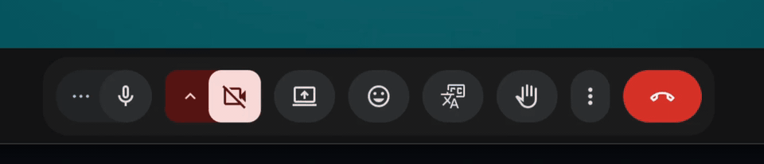

<div align="center">


# Penknife

**Mute the meeting you're in, find anything you copied, mark up any screenshot.**<br>
One tiny menu bar app for your Mac. Free and open source.

<a href="https://github.com/alexl-l/penknife/releases/latest"></a>


**English** · [Español](README.es.md)

<br><br>
<br>
<sub>Press one Penknife shortcut. The call mutes, and its own button updates.</sub>

</div>

## What's inside

Every part is a module. Turn off what you don't need and it uses no CPU or memory. Works on any Mac; no Touch Bar needed.

<table>
<tr>
<td width="50%" valign="top">

<h3>Microphone mute for meetings</h3>
One shortcut mutes the meeting you're in: Teams, Google Meet, Zoom, Slack Huddles or Webex. Only apps in a call count, and each uses its own shortcut, which you can edit in Settings. With no call, it mutes your Mac's microphone. The icon and status dot always show the real state.
</td>
<td width="50%" valign="top">

<h3>Clipboard history</h3>
Search, pin what you reuse and paste with ⌘1–⌘9. Passwords and other concealed items are never saved.
</td>
</tr>
<tr>
<td width="50%" valign="top">

<h3>Screenshots</h3>
Select an area or a window, mark it with arrows, text, highlighter, shapes, pen and blur, then copy or save. Nothing is uploaded.
</td>
<td width="50%" valign="top">

<h3>Music</h3>
Play, pause and skip in the player you choose. Headphone clicks go to that player, and Apple Music no longer opens by itself.
</td>
</tr>
</table>

### And in the menu bar
Mouse jiggler to keep your Mac awake and your status active, lock screen and a speed test that shows download, upload and latency in kbps, Mbps or Gbps. Every item has its own shortcut, and status dots show what is on. Alerts are small and quiet, and you choose which ones appear and for how long.

### Settings
One window in the style of System Settings: turn any module on or off and give it its own shortcut.


### Have a Touch Bar?
Penknife adds its own: brightness, keyboard light, volume, music, weather, CPU temperature, battery, speed test and time, one tap away. Icons follow the current state, and you choose which buttons appear and in what order.


A little extra: hold the mouse jiggler button for 3 seconds and slice fruit on the Touch Bar.


## Install

Prefer Homebrew? Run `brew trust alexl-l/tap && brew install --cask alexl-l/tap/penknife`. Otherwise:

1. [Download the latest release](https://github.com/alexl-l/penknife/releases/latest), unzip it and move `Penknife.app` to `/Applications`.
2. Open it. Penknife is not notarized (there is no paid Apple Developer account), so macOS blocks it the first time: go to **System Settings → Privacy & Security** and click **Open Anyway**.

   **No Open Anyway, or the warning keeps coming back?** This happens on Macs managed by a company or school, where a profile blocks apps that aren't notarized. Remove the "downloaded from the internet" mark in Terminal and open Penknife again:
   ```
   xattr -dr com.apple.quarantine /Applications/Penknife.app
   ```
   On a work Mac, check with your IT team first.
3. That's it. Penknife checks for updates once a day and asks before installing (menu → **Check for Updates…**).

<details>
<summary><b>Requirements</b></summary>

- macOS 26 or later, on any Mac.
- The Touch Bar section above is optional and needs a MacBook Pro with a Touch Bar.

</details>

<details>
<summary><b>Permissions</b></summary>

Penknife asks only for what the modules you turn on need:

- **Accessibility**: shortcuts that act on other apps, media keys, the mouse jiggler, and reading a meeting's mute button so the call and your Mac stay in sync.
- **Automation (Apple Events)**: to control Spotify and Apple Music.
- **Location** (optional): local weather.
- **Screen Recording**: screenshots.

</details>

<details>
<summary><b>The meeting and the Mac's microphone get out of sync in Chrome</b></summary>

When you press the shortcut, Penknife reads the meeting's mute button so the call and your Mac's microphone end up the same. Chrome shows that button to other apps only when its accessibility support is on, and it can be blocked:

1. Open `chrome://accessibility` (`opera://accessibility`, `edge://accessibility` or `brave://accessibility` in those browsers).
2. Make sure **Suppress automatic accessibility enablement from platform API consumers** is unchecked. Leave **Lock the current accessibility mode** unchecked too.
3. **Native accessibility API support** and **Web accessibility** must be on (they turn on by themselves once nothing blocks them). The other boxes aren't needed.

Safari needs nothing. If the button can't be read, Penknife still sends the meeting's shortcut.

</details>

<details>
<summary><b>Privacy</b></summary>

Penknife has no account, no analytics and no tracking.

- **Weather** sends only coordinates rounded to about 11 km to [Open-Meteo](https://open-meteo.com/). Open-Meteo sees your IP address.
- **Speed test** runs macOS's own `networkQuality` tool, which contacts Apple's test servers.
- **Clipboard history** and **screenshots** stay on your Mac.

</details>

<details>
<summary><b>Private APIs</b></summary>

Penknife is not an App Store app. It uses some private macOS frameworks, for example to show its own Touch Bar and to set screen and keyboard brightness. A macOS update can break a module. When that happens, the module stops working and the rest of the app keeps running.

</details>

<details>
<summary><b>Build from source</b></summary>

1. Create a code-signing certificate named `Penknife Local Signing` in your login keychain (Keychain Access → Certificate Assistant → Create a Certificate, type *Code Signing*). A stable signature keeps the privacy permissions between builds.
2. Run `scripts/install.sh`. It builds a Release version, signs it and installs it in `/Applications`.

</details>

See [CHANGELOG.md](CHANGELOG.md) for what changed in each version.

## License

[MIT](LICENSE). Third-party notices: [THIRD_PARTY_LICENSES.md](THIRD_PARTY_LICENSES.md).

Penknife is not affiliated with or endorsed by Apple or Spotify. Names are used only to describe compatibility.
