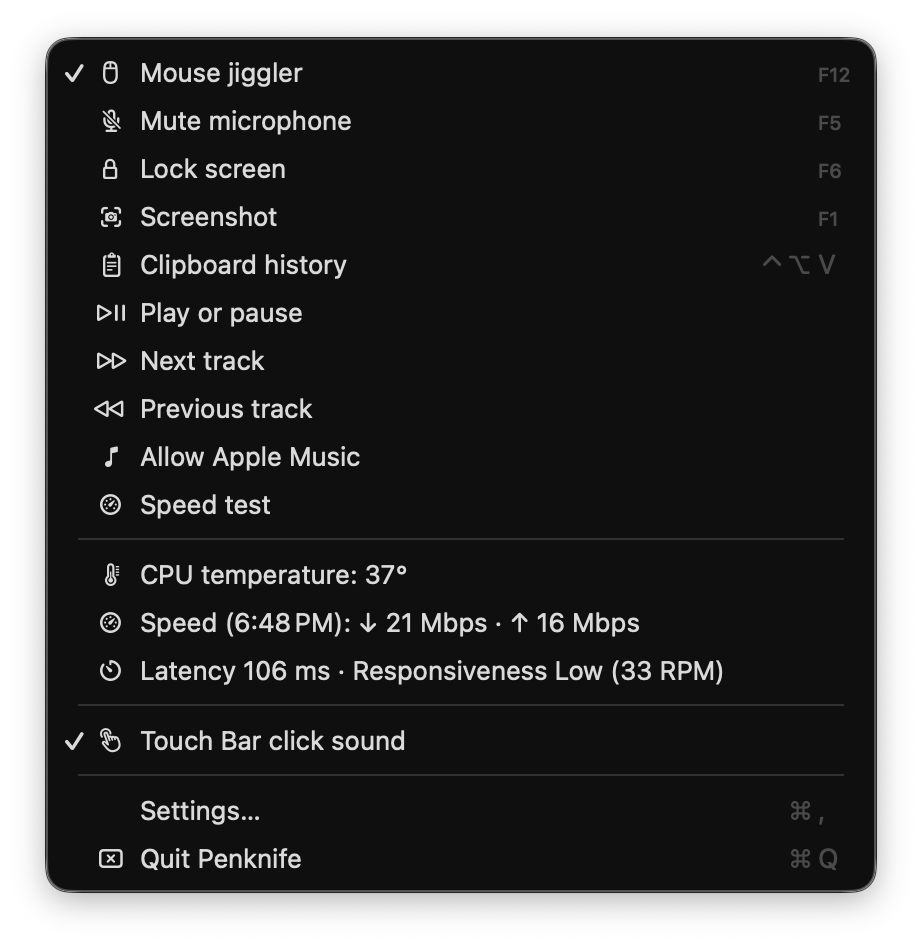
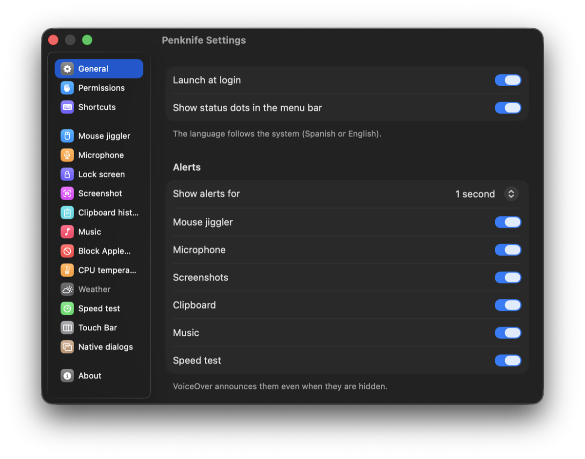

# Penknife

**The pocket knife for your Mac.** 
One small menu bar app that replaces Hammerspoon, MTMR, noTunes, Maccy and Lightshot.

**English** · [Español](README.es.md)

 

## What's inside

Every part is a module you can turn on or off.

### Touch Bar
Brightness, keyboard light, volume, music, weather, CPU temperature, battery, speed test and time. Icons follow the current state, and you choose which buttons appear and in what order.

<table>
<tr>
<td width="50%" valign="top">

<h3>Screenshots</h3>
An editor with arrows, text, highlighter, shapes, pen and blur. Frozen or live, area or window. Copy or save.
</td>
<td width="50%" valign="top">

<h3>Clipboard history</h3>
Search, pinned items and paste with ⌘1–⌘9. Password managers and concealed items are never saved.
</td>
</tr>
<tr>
<td width="50%" valign="top">

<h3>Music</h3>
Play, pause and skip in the player you choose. Headphone clicks go to that player, and Apple Music no longer opens by itself.
</td>
<td width="50%" valign="top">

<h3>Menu bar</h3>
Mouse jiggler, microphone mute, lock screen, speed test and CPU temperature, each with its own shortcut. Status dots show what is on.
</td>
</tr>
</table>

### Settings
One System Settings style window: every module on or off, with its own shortcuts.

### A little extra
Hold the jiggler button for 3 seconds and slice fruit on the Touch Bar.

## Install

1. [Download the latest release](https://github.com/alexl-l/penknife/releases/latest), unzip it and move `Penknife.app` to `/Applications`.
2. Open it. Penknife is not notarized (there is no paid Apple Developer account), so macOS blocks it the first time: go to **System Settings → Privacy & Security** and click **Open Anyway**.

<b>Requirements</b>

- macOS 26 or later.
- The Touch Bar module needs a MacBook Pro with a Touch Bar.

<b>Permissions</b>

Penknife asks only for what the modules you turn on need:

- **Accessibility**: shortcuts that act on other apps, media keys and the mouse jiggler.
- **Automation (Apple Events)**: to control Spotify and Apple Music.
- **Location** (optional): local weather.
- **Screen Recording**: screenshots.

<b>Privacy</b>

Penknife has no account, no analytics and no tracking.

- **Weather** sends only coordinates rounded to about 11 km to [Open-Meteo](https://open-meteo.com/). Open-Meteo sees your IP address.
- **Speed test** runs macOS's own `networkQuality` tool, which contacts Apple's test servers.
- **Clipboard history** and **screenshots** stay on your Mac.

<b>Private APIs</b>

Penknife is not an App Store app. It uses some private macOS frameworks, for example to show its own Touch Bar and to set screen and keyboard brightness. A macOS update can break a module. When that happens, the module stops working and the rest of the app keeps running.

<b>Build from source</b>

1. Create a code-signing certificate named `Penknife Local Signing` in your login keychain (Keychain Access → Certificate Assistant → Create a Certificate, type *Code Signing*). A stable signature keeps the privacy permissions between builds.
2. Run `scripts/install.sh`. It builds a Release version, signs it and installs it in `/Applications`.

See [CHANGELOG.md](CHANGELOG.md) for what changed in each version.

## License

[MIT](LICENSE). Third-party notices: [THIRD_PARTY_LICENSES.md](THIRD_PARTY_LICENSES.md).

Penknife is not affiliated with or endorsed by Apple, Spotify, Hammerspoon, MTMR, noTunes, Maccy or Lightshot. Names are used only to describe compatibility.
